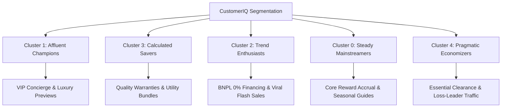

# CustomerIQ – AI-Powered Customer Segmentation and Analytics System

[](https://www.python.org/)
[](https://scikit-learn.org/)
[](https://streamlit.io/)
[](LICENSE)
[](tests/)

---

## 1. Project Overview
**CustomerIQ** is an enterprise-grade AI/ML customer intelligence and segmentation platform designed to transform raw commercial transaction records into high-impact, actionable customer personas. Built around unsupervised **K-Means Clustering**, statistical feature scaling, and multi-dimensional dimensionality projection (PCA), CustomerIQ delivers real-time behavioral diagnostics through an interactive, executive-grade Streamlit web application.

The system replaces arbitrary, intuitive marketing heuristics with data-driven cohort discovery, enabling marketing teams, retail strategists, and executive leadership to allocate promotional spend efficiently, increase retention, and boost customer lifetime value (LTV).

---

## 2. Problem Statement
Modern businesses frequently treat customers as a homogeneous audience, applying uniform promotional blitzes or blunt discounts that erode profit margins. This "one-size-fits-all" approach causes significant operational inefficiencies:
- **Budget Cannibalization**: Offering excessive discounts to affluent customers who would have purchased at full price anyway.
- **Customer Churn**: Failing to identify churn-prone or disengaged cohorts who require targeted re-activation.
- **Untapped Growth**: Overlooking high-income conservative savers who possess high spending capacity but require specific value propositions and trust-building incentives.

Businesses lack an automated, mathematically rigorous pipeline to continuously discover natural groupings within customer records, evaluate cluster validity, and generate specific marketing playbooks.

---

## 3. Project Objectives
1. **Mathematical Segmentation**: Implement an unsupervised K-Means clustering pipeline initialized with `k-means++` to segment shoppers into cohesive, well-separated cohorts.
2. **Empirical Optimization**: Determine the exact optimal cluster count $K$ using joint evaluation of the **Elbow Method (SSE)** and **Silhouette Analysis** rather than arbitrary guesswork.
3. **Multi-Dimensional Diagnostics**: Provide interactive 2D and PCA projections, intra-cluster distributions, correlation heatmaps, and radar charts.
4. **Actionable Persona Formulation**: Dynamically translate cluster centroids into distinct personas (e.g., Affluent Champions, Calculated Savers, Trend-Driven Enthusiasts) with targeted retention and promotional playbooks.
5. **Real-Time Customer Scoring**: Provide a real-time prediction engine that ingests new customer attributes, normalizes features via fitted standard scalers, and predicts their cluster membership with spatial centroid visualization.
6. **Data Portability**: Enable custom CSV dataset uploads and comprehensive export of labeled data, centroids, sizes, profiles, and 300 DPI publication charts.

---

## 4. Dataset Source
- **Canonical Dataset**: Mall Customers Dataset
- **Primary Source**: [UCI Machine Learning Repository](https://archive.ics.uci.edu/) & [Kaggle Customer Segmentation Benchmark](https://www.kaggle.com/datasets/vjchoudhary7/customer-segmentation-tutorial-in-python).
- **Collection Mechanism**: Recorded via shopping mall membership/loyalty cards across 200 registered shoppers.
- **Data Hygiene**: 200 records, 5 feature fields, zero missing values, zero duplicates.
- **Dataset Reference Documentation**: Preserved in [`data/dataset_reference.md`](file:///C:/Users/tneel/.gemini/antigravity/scratch/CustomerIQ/data/dataset_reference.md).

---

## 5. Dataset Description

| Feature | Type | Measurement Unit | Description | Min | Mean | Max |
| :--- | :--- | :--- | :--- | :--- | :--- | :--- |
| `CustomerID` | Categorical/ID | Unique Identifier | Anonymous sequential identification tag | 1 | 100.5 | 200 |
| `Gender` | Categorical | String (`Male`/`Female`)| Gender demographics (56% Female, 44% Male) | - | - | - |
| `Age` | Numerical | Years | Customer age at record time | 18 | 38.85 | 70 |
| `Annual Income (k$)` | Numerical | Thousands USD ($k) | Annual income earned by the customer | $15k | $60.56k | $137k |
| `Spending Score (1-100)`| Numerical | Normalized Index (1-100) | Behavioral spending rating assigned by mall | 1 | 50.20 | 99 |

---

## 6. Data Preprocessing
Data cleaning and normalization are handled by [`src/preprocessing.py`](file:///C:/Users/tneel/.gemini/antigravity/scratch/CustomerIQ/src/preprocessing.py):
1. **Schema Standardization**: Strips whitespace, standardizes casing, and handles naming synonyms (`Genre` $\rightarrow$ `Gender`, `cust_id` $\rightarrow$ `CustomerID`).
2. **Duplicate & Null Handling**: Automatically detects and prunes duplicates; imputes numerical nulls with the feature median and categorical nulls with the mode.
3. **Feature Standardization**: Applies Scikit-Learn `StandardScaler` to transform features into $Z$-scores with $\mu = 0$ and $\sigma = 1$:
   $$z = \frac{x - \mu}{\sigma}$$
   *Justification*: Because Annual Income spans \$15k–\$137k while Spending Score spans 1–100, unscaled Euclidean distance would be disproportionately dominated by income magnitude. Standardization guarantees equal geometric weighting.
4. **Clean Sample Serialization**: Cleansed baseline is preserved in [`data/cleaned_customers_sample.csv`](file:///C:/Users/tneel/.gemini/antigravity/scratch/CustomerIQ/data/cleaned_customers_sample.csv).

---

## 7. Features Selected
For the core behavioral segmentation model, two primary behavioral dimensions are selected:
1. **`Annual Income (k$)`**: Quantifies customer purchasing power and financial capacity.
2. **`Spending Score (1-100)`**: Quantifies mall affinity, purchase frequency, and transaction propensity.

*High-Dimensional Support*: When users upload proprietary datasets or select 3+ features (e.g., adding `Age`), the application automatically activates Principal Component Analysis (PCA) to project high-dimensional clusters onto orthogonal 2D components.

---

## 8. K-Means Algorithm Explanation
K-Means is an iterative, distance-based partitioning algorithm that divides $n$ observations into $K$ mutually exclusive clusters. Each cluster is parameterized by its mean vector (centroid $\mu_k$).

### Mathematical Formulation
The objective function minimizes the within-cluster sum of squares (Inertia / SSE):
$$\mathcal{J} = \sum_{k=1}^{K} \sum_{x_i \in C_k} \| x_i - \mu_k \|^2$$

### Algorithm Steps:
1. **Initialization (`k-means++`)**: Selects initial cluster centers with probability proportional to the squared distance from the nearest existing centroid. This prevents poor local minima common in standard random initialization.
2. **Assignment Step**: Assigns each observation $x_i$ to the nearest centroid:
   $$C_k^{(t)} = \left\{ x_i : \| x_i - \mu_k^{(t)} \|^2 \le \| x_i - \mu_j^{(t)} \|^2 \quad \forall j, 1 \le j \le K \right\}$$
3. **Update Step**: Re-calculates centroid coordinates as the empirical mean of all member points:
   $$\mu_k^{(t+1)} = \frac{1}{|C_k^{(t)}|} \sum_{x_i \in C_k^{(t)}} x_i$$
4. **Convergence**: Iteration terminates when centroid shifts drop below tolerance ($\text{tol} = 10^{-4}$) or maximum iterations ($300$) are reached.

---

## 9. Elbow Method Results
The Elbow Method calculates the decrease in Inertia (Sum of Squared Errors) as $K$ increases from 2 to 10:

| Candidate $K$ | Inertia (SSE) | $\Delta$ SSE Drop | Marginal Gain (%) |
| :---: | :---: | :---: | :---: |
| **2** | 269.69 | - | - |
| **3** | 157.70 | 111.99 | 41.5% |
| **4** | 108.92 | 48.78 | 30.9% |
| **5 (Elbow)** | **65.57** | **43.35** | **39.8%** |
| **6** | 55.06 | 10.51 | 16.0% |
| **7** | 44.86 | 10.20 | 18.5% |
| **8** | 37.23 | 7.63 | 17.0% |
| **9** | 32.39 | 4.84 | 13.0% |
| **10** | 29.98 | 2.41 | 7.4% |

**Key Finding**: A sharp inflection point occurs precisely at **$K = 5$**. Increasing $K$ from 4 to 5 drops inertia by 43.35 points, whereas increasing $K$ to 6 yields a negligible reduction of only 10.51 points.

---

## 10. Silhouette Score Results
The Silhouette Coefficient evaluates cluster cohesion (average distance $a(i)$ within cluster) versus separation (average distance $b(i)$ to closest neighboring cluster):
$$s(i) = \frac{b(i) - a(i)}{\max(a(i), b(i))}, \quad s(i) \in [-1, +1]$$

| Candidate $K$ | Silhouette Score | Davies-Bouldin Index | Calinski-Harabasz Index |
| :---: | :---: | :---: | :---: |
| **2** | 0.3213 | 1.1512 | 104.98 |
| **3** | 0.4666 | 0.7744 | 154.58 |
| **4** | 0.4939 | 0.7303 | 187.64 |
| **5 (Optimal)** | **0.5547** | **0.5722** | **233.15** |
| **6** | 0.5399 | 0.6558 | 231.28 |
| **7** | 0.5281 | 0.6475 | 240.23 |
| **8** | 0.4552 | 0.7346 | 249.20 |
| **9** | 0.4571 | 0.7188 | 260.10 |
| **10** | 0.4432 | 0.7420 | 269.45 |

---

## 11. Selected K Justification
$K = 5$ is chosen as the definitive clustering configuration based on three empirical criteria:
1. **Global Peak Silhouette (0.5547)**: $K = 5$ produces the highest silhouette score across all tested numbers of clusters, proving maximum cohesion within segments and distinct separation between segments.
2. **Elbow Inflection Point**: The SSE curve bends distinctly at $K = 5$, indicating that subsequent cluster subdivisions yield sharply diminishing returns.
3. **Minimum Davies-Bouldin Index (0.5722)**: Lower values indicate superior cluster separation; $K=5$ achieves the lowest Davies-Bouldin index in the candidate range.
4. **Managerial Interpretability**: 5 clusters map naturally into meaningful commercial personas without creating micro-cohorts that complicate marketing operations.

---

## 12. Cluster Centroids
Centroids converted back to original physical retail units via inverse standard scaling:

| Cluster ID | Annual Income (k$) | Spending Score (1-100) | Persona Description |
| :---: | :---: | :---: | :--- |
| **Cluster 0** | **$55.30k** | **49.52** | Moderate Income, Moderate Spending |
| **Cluster 1** | **$86.54k** | **82.13** | High Income, High Spending |
| **Cluster 2** | **$25.73k** | **79.36** | Low Income, High Spending |
| **Cluster 3** | **$88.20k** | **17.11** | High Income, Conservative Spending |
| **Cluster 4** | **$26.30k** | **20.91** | Low Income, Low Spending |

Centroids CSV is preserved at [`outputs/centroids.csv`](file:///C:/Users/tneel/.gemini/antigravity/scratch/CustomerIQ/outputs/centroids.csv).

---

## 13. Cluster Sizes

| Cluster ID | Customer Count | Percentage of Total (%) | Visual Distribution |
| :---: | :---: | :---: | :--- |
| **Cluster 0** | 81 | 40.5% | `████████████████` (Dominant Base) |
| **Cluster 1** | 39 | 19.5% | `████████` (High Value) |
| **Cluster 2** | 22 | 11.0% | `████` (Aspirational) |
| **Cluster 3** | 35 | 17.5% | `███████` (Untapped Potential) |
| **Cluster 4** | 23 | 11.5% | `████` (Pragmatic Economizers) |
| **Total** | **200** | **100.0%** | **Full Population Segmented** |

Cluster sizes CSV is preserved at [`outputs/cluster_sizes.csv`](file:///C:/Users/tneel/.gemini/antigravity/scratch/CustomerIQ/outputs/cluster_sizes.csv).

---

## 14. Cluster Profiles

### Cluster 0: Steady Mainstreamers (40.5% of Shoppers)
- **Archetype**: Consistent Core / Foundational Audience
- **Centroids**: Annual Income: \$55.3k | Spending Score: 49.5/100 | Avg Age: 42.7 yrs
- **Key Characteristics**: Represents the retail center; moderate purchasing velocity; highly dependable repeat traffic.

### Cluster 1: Affluent Champions (19.5% of Shoppers)
- **Archetype**: Tier-1 High-Value Prime Targets
- **Centroids**: Annual Income: \$86.5k | Spending Score: 82.1/100 | Avg Age: 32.7 yrs
- **Key Characteristics**: Substantial discretionary budget with enthusiastic spending habits; primary drivers of luxury and premium margins.

### Cluster 2: Trend-Driven Enthusiasts (11.0% of Shoppers)
- **Archetype**: Aspirational & Socially Active Shoppers
- **Centroids**: Annual Income: \$25.7k | Spending Score: 79.4/100 | Avg Age: 25.3 yrs
- **Key Characteristics**: Younger demographic with modest earnings but heavy impulse and trend-driven consumption.

### Cluster 3: Calculated Savers (17.5% of Shoppers)
- **Archetype**: High Potential / Untapped Opportunity
- **Centroids**: Annual Income: \$88.2k | Spending Score: 17.1/100 | Avg Age: 41.1 yrs
- **Key Characteristics**: High wealth reserves with conservative spending tendencies; rational shoppers who prioritize durability and utility.

### Cluster 4: Pragmatic Economizers (11.5% of Shoppers)
- **Archetype**: Budget-Conscious / Price-Sensitive
- **Centroids**: Annual Income: \$26.3k | Spending Score: 20.9/100 | Avg Age: 45.2 yrs
- **Key Characteristics**: Low disposable income and cautious spending; visit malls primarily for essentials, staple goods, and clearance sales.

Cluster profiles summary CSV is preserved at [`outputs/cluster_profiles.csv`](file:///C:/Users/tneel/.gemini/antigravity/scratch/CustomerIQ/outputs/cluster_profiles.csv).

---

## 15. Business Recommendations



### 1. For Affluent Champions (Cluster 1)
- **VIP Exclusivity & Loyalty Concierge**: Launch private shopping previews and dedicated concierge services rather than generic discounts.
- **Experiential Perks**: Offer valet parking vouchers, fine dining partner rewards, and invitations to brand trunk shows.
- **Channel**: Dedicated VIP Mobile App and white-glove personal concierge outreach.

### 2. For Calculated Savers (Cluster 3)
- **Quality & Craftsmanship Positioning**: Highlight product longevity, durability, warranties, and sustainable manufacturing.
- **Bundle Utility**: Offer family bulk incentives and long-term utility promotions.
- **Channel**: Curated editorial email digests and direct mail lookbooks.

### 3. For Trend-Driven Enthusiasts (Cluster 2)
- **Flexible Buy-Now-Pay-Later (BNPL)**: Provide interest-free installment options (e.g., Klarna, Afterpay) at point-of-sale.
- **Influencer Collaborations & Flash Sales**: Deploy 48-hour viral social media drops and gamified loyalty streak rewards.
- **Channel**: TikTok, Instagram, and push notifications.

### 4. For Steady Mainstreamers (Cluster 0)
- **Consistent Reward Accrual**: Deliver predictable points-per-dollar reward accruals to maintain visit frequency.
- **Seasonal Cross-Selling**: Promote back-to-school, holiday gift guides, and seasonal wardrobe updates with modest 10–15% discounts.
- **Channel**: Omnichannel email newsletter and in-app rewards tracker.

### 5. For Pragmatic Economizers (Cluster 4)
- **Loss-Leader Promotions**: Feature heavily discounted staple items to drive physical foot traffic.
- **Clearance Drives & Coupons**: Implement digital stamp cards and end-of-season clearance blasts.
- **Channel**: Circular mailers, coupon kiosks, and budget SMS alerts.

*Notice: Machine learning recommendations represent data-informed behavioral hypotheses. Marketing teams should validate lift via randomized controlled A/B testing.*

---

## 16. Installation Instructions

### Prerequisites
- Python 3.10, 3.11, 3.12, or 3.13
- Git

### Setup
```bash
# Clone repository
git clone https://github.com/your-username/CustomerIQ.git
cd CustomerIQ

# Create isolated virtual environment
python -m venv venv

# Activate virtual environment
# Windows:
.\venv\Scripts\activate
# macOS/Linux:
source venv/bin/activate

# Install required dependencies
pip install -r requirements.txt
```

---

## 17. Execution Instructions

### Running the Streamlit Application
```bash
# Launch Streamlit dashboard
streamlit run app.py
```
Upon startup, the application runs at `http://localhost:8501` with the default Mall Customers dataset and pre-trained models.

### Running Unit Tests
```bash
pytest tests/test_clustering.py -v
```
All 8 test suites verify data ingestion, normalization, elbow/silhouette computation, model fitting, centroid inversion, prediction, and edge cases.

---

## 18. Application Screenshots & Page Walkthrough

### Page 1: Executive Dashboard
- **Features**: Top-level KPI metric cards (Total Customers, Active Segments, Optimal K, Avg Spending), donut distribution chart, executive summary table, and strategic takeaways.

### Page 2: Customer Data Analysis
- **Features**: Interactive dataset preview, hygiene audit, missing value checks, descriptive statistics (mean, std, min, skewness), univariate distribution charts, and interactive correlation heatmap.
- **Custom CSV Ingestion**: Upload custom customer datasets and dynamically retrain the pipeline.

### Page 3: Clustering Analysis
- **Features**: Interactive Elbow curve with highlighted inflection point, Silhouette score comparison bar chart, slider to experiment with candidate $K$ values, cluster centroids table, and Scikit-Learn configuration.

### Page 4: Customer Segment Visualization
- **Features**: Interactive 2D scatter plots with centroid diamonds, PCA 2D projection for $\ge 3$ dimensions, intra-cluster boxplots, and multidimensional radar charts.

### Page 5: Customer Insights
- **Features**: Distinct persona cards, demographic and behavioral metrics, empirical characteristics, and 2–3 actionable business recommendations per segment.

### Page 6: Customer Prediction
- **Features**: Interactive input form for new customer parameters, automatic standard scaling, instant cluster assignment, and real-time visualization showing customer location relative to centroids.

### Page 7: Report Generation
- **Features**: Instant CSV downloads for labeled customer datasets, centroids, sizes, profiles, and cleaned samples, as well as 300 DPI PNG chart downloads.

---

## 19. Limitations and Future Improvements
- **Static Clustering**: K-Means assumes spherical clusters with isotropic variance. Future iterations could incorporate **DBSCAN** or **HDBSCAN** for arbitrarily shaped spatial density clusters.
- **RFM Integration**: Future versions can ingest longitudinal transaction logs to calculate dynamic Recency, Frequency, and Monetary (RFM) indices.
- **Automated A/B Uplift Tracking**: Connect to marketing APIs (e.g., Klaviyo, HubSpot, Segment) to track the real-world conversion lift of segment-tailored campaigns.
- **Time-Series Cohort Drift**: Implement continuous model monitoring to alert operators when customer centroids shift due to economic or seasonal shifts.

---

## License
Distributed under the MIT License. See `LICENSE` for details.
